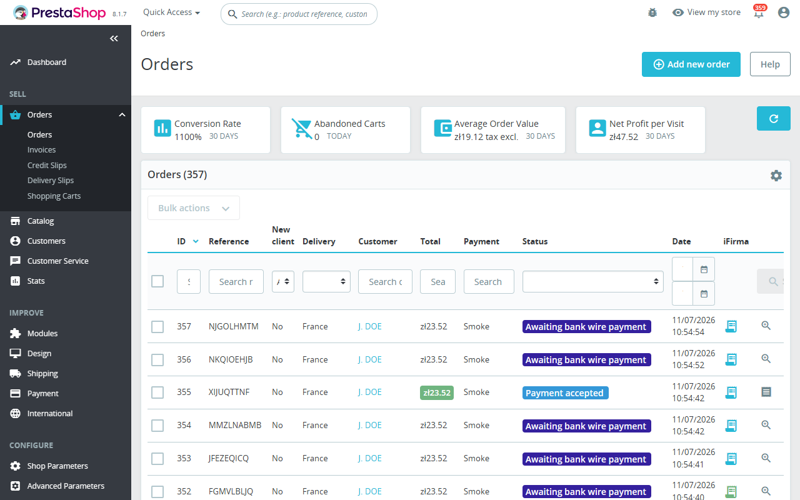
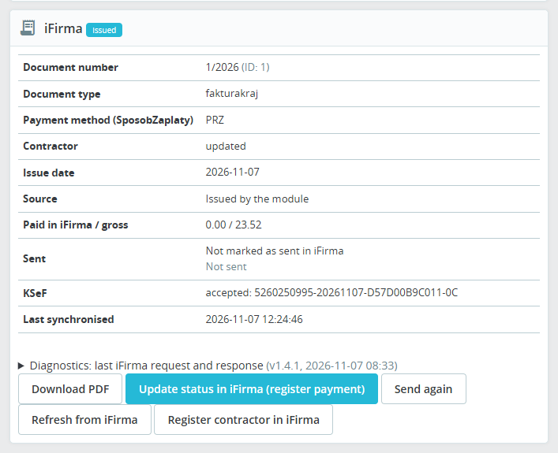
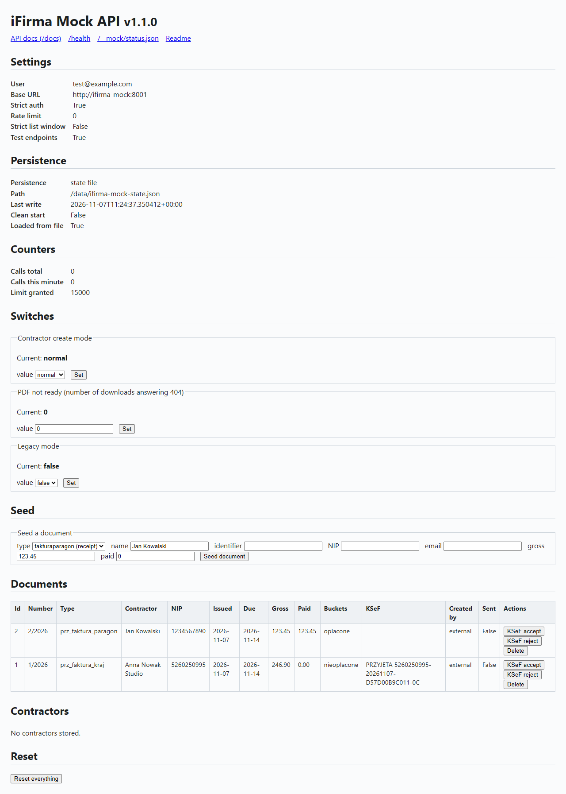

# Prestashop Module for integration with iFirma – Receipts & Invoices (PrestaShop module)

Two‑way integration between **PrestaShop** (8.x / 9.x) and the **iFirma**
accounting service (`www.ifirma.pl`). It issues accounting documents from shop orders, brings the
PDF back to the customer and keeps the payment and KSeF status in line with iFirma.

| Feature | Where |
|---------|-------|
| **Issue a document** in iFirma from an order | Back office → *Orders → (order) → iFirma panel → “Create Receipt”* |
| **Issue from the Orders list**, and the bulk *Issue iFirma documents* | Back office → *Orders* → the iFirma cell of an order |
| **Documents list** with filters, a *Needs attention* preset and bulk retry, resend and refresh | Back office → *Orders → iFirma documents* |
| **Notification tab** with the documents that need attention | The iFirma tab of the back-office notification bell |
| **Automatic issuance** when an order reaches a chosen status | Module configuration → *Auto‑create on order status* |
| **PDF back to the customer** | Front office → *My account* block **and** the *Order detail* page; optional e‑mail with the PDF attached |
| **Payment and status sync** (register the payment, read it back) | Back office → iFirma panel → “Update status in iFirma”, “Refresh from iFirma”, and a cron URL |
| **KSeF submission** of issued invoices | Pipeline step `ksef`; “Send to KSeF” in the order panel |
| **Customer data‑change requests** before a document is issued | Front office → *Order detail* → “Request a change to billing data”; review in the order panel |
| **Guest data-change requests** with a one-time code e-mailed to the order address | Front office → *guest order tracking* → “Change invoice data” (`/module/ifirma/guestrequest`) |
| **Automatic approval** of data-change requests (`none`, `safe`, `all`) | Module configuration → *Accept data change requests automatically* |
| **iFirma print template** (logo and layout of the document) | Module configuration → *Document template* |
| **Order stamp prefix** for several shops in one iFirma account | Module configuration → *Order stamp prefix* |
| **Shop webpage** in the e-mails, the document comments and the PDF file names (`<shop-domain>-<number>.pdf`) | Module configuration → *Shop webpage* |
| **Contractor linking** to contractors that already exist in iFirma | Module configuration (CSV import) and the back‑office customer page |

The iFirma column in the back‑office Orders list shows at a glance which orders have a document:

The iFirma panel on an order page issues the document, shows its state and downloads the PDF:

## Compatibility

PrestaShop **8.0 – 9.x**, PHP **7.2 – 8.x**. PrestaShop 1.7 is supported up to module 1.1.x. Verified with the Docker smoke suite on PrestaShop 8.1.7 (PHP 8.1) and 9.1.4 (PHP 8.5); see `tests/smoke/README.md`. Requires the PHP `curl`, `hash`
and `mbstring` extensions.

## Installation

1. Copy the `ifirma/` folder to `<prestashop>/modules/`.
2. Back office → **Modules** → search *iFirma* → **Install**.
3. Open the module configuration and fill in the connection fields:
   - **iFirma login** – your account login / e‑mail.
   - **API key: faktura** – the hexadecimal *faktura* key from
     iFirma → *Konfiguracja → Abonent → API → Klucze*.
   - **Document type** – *Domestic VAT invoice* (`fakturakraj`), the only enabled and default
     type. *Invoice to receipt* (`fakturaparagon`) is disabled for now; a stored `fakturaparagon`
     value is treated as `fakturakraj`.
   - **Payment registration type** – URL token for the payment endpoint
     (default `prz_faktura_kraj`; adjust to your document/payment type).
4. Optionally set **Auto‑create on order status** (the trigger state) to issue documents automatically.
   With the default delivery channel, documents are then e‑mailed to customers on the next trigger;
   read [Delivery](docs/usage.md#delivery) first, or choose *Do not send*.

Every other setting (API key *abonent*, delivery channel, duplicate check, data‑change requests,
status sync, cron endpoint, rate limits) is described in [docs/configuration.md](docs/configuration.md).
After updating the module, clear the PrestaShop cache (Advanced Parameters > Performance > Clear cache).

## How it is used

When an order reaches the status chosen in **Auto‑create on order status**, or when you click
**Create Receipt**, the module runs one issuance pipeline for that order:
`hold → guard → create → number → ksef → deliver`.

- **hold** waits while the customer has a pending data‑change request; **guard** looks in iFirma for a
  document that already belongs to the order and adopts it instead of creating a second one.
- **create** issues the document, **number** reads its number back, **ksef** submits it to KSeF when the
  mode asks for it, and **deliver** sends the PDF through the configured channel.
- The first step that cannot continue stops the run; the outcome of every step is stored on the order's
  receipt record, and a failure never breaks the PrestaShop status change.

The registered customer sees the document on the *Order detail* page and under *My account* and
downloads the PDF through a secured link; internal errors are never shown. The page for each state
is described in [docs/usage.md](docs/usage.md#what-the-customer-sees).

An order whose newest record is `unknown`, `duplicate_suspected`, `held` or `error` needs a look in the
iFirma panel; what each state means and what to do is in
[States that need attention](docs/usage.md#states-that-need-attention).

The module refreshes its view of every issued document (paid amount, sent flag, KSeF status and number,
documents removed in iFirma) through the **Refresh from iFirma** button, an opportunistic refresh when the
customer opens the order, and a cron URL for bulk sync that the configuration page shows with its token.
See [Monitoring](docs/usage.md#monitoring) and [Rate limits](docs/configuration.md#rate-limits).

### Delivery, KSeF and the duplicate guard

- **Delivery** – the PDF is attached to a shop e‑mail (default), sent by iFirma itself, or not sent at all.
  See [Delivery](docs/usage.md#delivery).
- **KSeF** – invoices to buyers with a NIP are submitted to the National e‑Invoicing System by default;
  `all` and `off` are available. See [KSeF (e-invoicing)](docs/usage.md#ksef-e-invoicing).
- **Duplicate guard** – before creating a document the module looks for one that already belongs to the
  order, whether it was made by the module, by iFirma's own integrator or by hand. Do not run iFirma's own
  PrestaShop integrator and automatic issuance on the same account. See
  [Duplicate guard](docs/usage.md#duplicate-guard).

### Existing contractors

By default the module registers one iFirma contractor per customer (`PS-C<id_customer>`). If you already keep
contractors in iFirma, import the CSV export on the configuration page or link a customer by hand from the
back‑office customer page. See [docs/contractors.md](docs/contractors.md).

## Test stack

The mock iFirma API and the Docker test stack live in the `test-stack/` git submodule
([SecCodeSmith/test-stack](https://github.com/SecCodeSmith/test-stack), MIT). The mock keeps its state in a
file, so documents survive a restart. It also catches the shop's e-mails over SMTP (port 1025) and shows them on its status page at `/__mock/status`, where the smoke suite checks the e-mails the module sends:

Set‑up, builds and the submodule are described in [docs/development.md](docs/development.md); the stack
itself in [test-stack/README.md](test-stack/README.md).

## Getting help

When something goes wrong, start with [docs/troubleshooting.md](docs/troubleshooting.md): it lists the iFirma
error codes and the fixes for the common problems. To report a problem, copy the diagnostics block of the
order's iFirma panel (request, response, contractor step, last error) and the relevant lines from
Advanced Parameters > Logs (messages start with "iFirma"); neither contains API keys.

## Documentation

| Page | Contents |
|------|----------|
| [docs/architecture.md](docs/architecture.md) | How the module is built: hooks, controllers, classes, the issuance pipeline, data model, API surface, test harness |
| [docs/configuration.md](docs/configuration.md) | Settings walk-through (API key fields, base URL, cron header, the pause after a rejected key), every configuration key, the permission levels, duplicate guard settings, rate limits |
| [docs/usage.md](docs/usage.md) | Issuing documents, orders list and its Issue action, the iFirma documents list with bulk actions, monitoring, the notification tab and cron, duplicate guard, what the customer sees and the download limits, delivery, KSeF, customer page, data‑change requests, auto-accept and guest orders, and their limits |
| [docs/contractors.md](docs/contractors.md) | Linking existing iFirma contractors: CSV import, matching while issuing, manual links |
| [docs/upgrading.md](docs/upgrading.md) | What to do when upgrading from 1.0.x, to 1.2.0, 1.4.0, 1.4.1, 1.5.0 and 1.6.0 |
| [docs/development.md](docs/development.md) | Unit tests, package builds, the test‑stack submodule, releases, dev dependencies |
| [docs/troubleshooting.md](docs/troubleshooting.md) | iFirma error codes and fixes for the common problems, the pause after a rejected key, rate-limited bulk runs, permission messages, download limits |
| [test-stack/README.md](test-stack/README.md) | The mock iFirma API and the Docker test stack |
| [tests/smoke/README.md](tests/smoke/README.md) | The Docker smoke suite on PrestaShop 8.1 and 9.1 |
| [tests/Stubs/README.md](tests/Stubs/README.md) | The PrestaShop stubs used by the unit tests |

## Changelog

### 1.6.0

- **Guest data-change requests**: visitors who ordered without an account change the invoice data after a six-digit code sent to the order e-mail (valid 15 minutes, single use, limited resends). See [Guest orders](docs/usage.md#guest-orders).
- **Auto-accept** of data-change requests (`none` by default, `safe` or `all`); see [Customer data-change requests](docs/usage.md#customer-data-change-requests).
- **iFirma print template**, **order stamp prefix** and **shop webpage** settings ([configuration](docs/configuration.md#settings-walk-through)); the webpage and the shop logo also brand the module's e-mails.
- **PDF file names** are now `<shop-domain>-<number>.pdf`. See [Upgrading to 1.6.0](docs/upgrading.md#upgrading-to-160).

### 1.5.0

- **iFirma documents list** (*Orders > iFirma documents*): the module's records with filters, a *Needs attention*
  preset and row actions (retry issuance, send again, refresh, download PDF). Bulk retry issuance, send again and
  refresh from iFirma run in batches under the rate guard, show a summary with each outcome and write one log entry.
- **Issue from the Orders list**: an Issue action in the iFirma cell of an order without a document, and the bulk
  action *Issue iFirma documents*.
- **Notification tab**: an iFirma tab in the back-office notification bell lists the newest 20 records that need
  attention; each employee has an unseen counter.
- **Permissions**: the tab has three levels (view, issue, manage) that are read from the Permissions page, and the
  server checks them for every action. Behaviour change: profiles without the View level on the tab no longer see the
  iFirma panels, the Orders-list column or the customer-page panel until they are granted it.
- **Upgrade**: the tab moves under Orders, the `actionAdminControllerSetMedia` hook is registered, `ifirma_receipt`
  gets `last_download_at` and the index `idx_date_upd`, and `IFIRMA_AUTH_FAILURE` is created. Release as a minor
  version. See [Upgrading to 1.5.0](docs/upgrading.md#upgrading-to-150).
- **Hardening** (security audit of 2026-11-07, by finding id):
  - S1: state-changing AJAX actions check the employee's level on the server, on PrestaShop 8 and 9 alike.
  - S2: the customer PDF download is limited to one fetch per document per 30 seconds and ten per customer per minute.
  - S3: payment amounts must be positive, have at most two decimals and not exceed the order total.
  - S4: the base URL must be `https` (`http` only in developer mode or for local hosts); the cURL transport allows
    HTTP and HTTPS only, follows no redirects and stops at 20 MB.
  - S5: after iFirma rejects the credentials, calls are paused for 15 minutes or until the settings are saved.
  - S6: internal error text no longer reaches the browser; the details go to the PrestaShop log.
  - S7: the PDF file name is built from safe characters only.
  - S9: the API key fields are password inputs; the cron token can be sent in the `X-Ifirma-Token` header.
  - S10: tokens come only from `random_bytes()`, with no weaker fallback.
  - S11: the per-minute rate counter is incremented by one atomic statement.
  - S12: the text of a data-change request is validated and length-limited.
  - S13: data-change requests are limited to one per order every 10 minutes and ten per customer per day.
  - S14: array input is refused instead of raising an error, and the optional keys are checked as hexadecimal.
  - S15: the delivery e-mail variables are HTML-escaped.
  - S16: PDF responses send `X-Content-Type-Options: nosniff`.
  - S17: token values are read as scalars before they reach a query.
  - S8 (the synchronous PDF retries inside the order-status hook) is deferred to its own change.

## Legal Disclaimer & Trademarks

iFirma is a registered trademark of IFIRMA SA.

This module is an independent third-party open-source integration and is not officially affiliated with, endorsed by, or sponsored by IFIRMA SA.

The name "iFirma" and associated references are used strictly for identification, nominative reference, and descriptive compatibility purposes (interoperability / prawo cytatu) to inform users about the third-party accounting system with which this PrestaShop module integrates.
