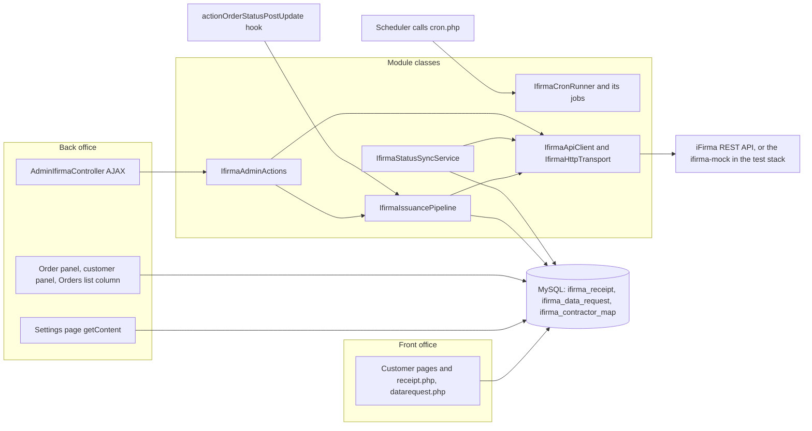
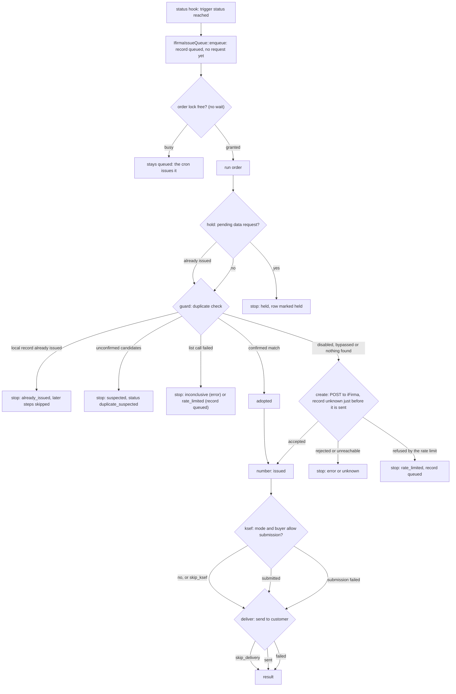

# Architecture

How the iFirma module is built: what runs where, which class does what, how a document gets issued, the data model, the API rules, and the test and release tooling. Back to the [README](../README.md).

## What runs where

The module (`ifirma.php`, class [`Ifirma`](../ifirma.php), version 1.4.1, PrestaShop 8.0 to 9.99.99) runs inside PrestaShop. There is no daemon of its own: work happens in the back office (an administrator clicks a button), in the front office (a customer opens a page), in a PrestaShop hook (an order changes status) or in the cron endpoint (an external scheduler calls a URL). All calls to iFirma leave through one cURL transport. In the test stack the same calls go to the mock instead.



The customer pages do not start the pipeline: the front controllers read and write the data-request and receipt rows, and a request the customer filed is resolved in the back office, where `IfirmaDataRequestActions` calls `IfirmaIssuancePipeline::resumeAfterRequest()` after an approve or a reject.

## Entry points

**Module class** [`ifirma.php`](../ifirma.php): `install()` creates the tables ([`sql/install.php`](../sql/install.php)), the default configuration values, the `AdminIfirma` tab and registers ten hooks; `getContent()` is the settings page (save the settings, regenerate the cron token, import a contractor CSV, reset the contractor map).

**Hooks** registered by `install()`:

| Hook | What it does |
|------|--------------|
| `displayAdminOrderMainBottom` | Renders the iFirma panel on the order page (`renderAdminOrderPanel()`). |
| `displayAdminCustomers` | Renders the contractor panel on the customer page (link state, search, register). |
| `displayCustomerAccount` | Adds the document and request entry to the customer's account page (nothing when the customer is not logged in or has nothing to show). |
| `displayOrderDetail` | Shows the document and the data-change request on the customer's order page; refreshes a stale remote state first. |
| `actionOrderStatusPostUpdate` | Runs `IfirmaIssuancePipeline::onOrderStatusChange()` for the new order state. |
| `header` | Registers `views/css/ifirma.css` on front-office pages. |
| `actionOrderGridDefinitionModifier` | Adds the "iFirma" column to the Orders list. |
| `actionOrderGridQueryBuilderModifier` | Joins the newest module record of each listed order (via [`IfirmaOrderGridIndicator`](../classes/IfirmaOrderGridIndicator.php)). |
| `actionOrderGridPresenterModifier` | Fills the cell of that column for each record. |
| `actionAdminControllerSetMedia` | Back office: adds the notification-tab script and the module stylesheet to every page for employees with the view level, and the bulk script on the Orders list and the documents list for those who may issue or manage. Passes the `ifirmaAdmin` variable (URL, levels, batch sizes, poll interval, words) to the scripts. See [Back-office scripts](#back-office-scripts). |

**Admin controller** [`controllers/admin/AdminIfirmaController.php`](../controllers/admin/AdminIfirmaController.php) is the tab `AdminIfirma` (menu *Orders > iFirma documents*). It has two parts:

- **The documents list**: a legacy list of the `ifirma_receipt` table (`fields_list`, filters, the preset `ifirma_preset=attention`, the three native bulk entries). Row buttons are rendered by list callbacks. Without JavaScript the bulk entries only explain that they need it (`processBulk*()`).
- **AJAX actions** (`ajaxProcess<Name>()`, called with `ajax=1&action=<Name>`), each answering the JSON envelope (`success`, `message`, `data`). Every action looks up its level in a static table and answers HTTP 403 with the same envelope when the employee lacks it (see Security notes):

| Level | Actions |
|-------|---------|
| view | `DownloadPdf`, `IssueFeed`, `IssueFeedSeen`, `CustomerCheck`, `CustomerSearch`, `CustomerCountRemote`, `CustomerLink`, `CustomerUnlink`, `CustomerRegister` (the last three also need the Customers edit permission) |
| issue | `CreateReceipt`, `IssueAnyway`, `LinkCandidate`, `RegisterContractor`, `IssueFromList`, and `BulkRun` with kind `issue` or `retry` |
| manage | `UpdateStatus`, `ResendDocument`, `SendToKsef`, `RefreshStatus`, `ApproveRequest`, `RejectRequest`, and `BulkRun` with kind `resend` or `refresh` (an unknown kind needs manage) |

`BulkRun` runs one batch through [`IfirmaBulkRunner`](../classes/IfirmaBulkRunner.php). `IssueFromList` creates one order's document from the Orders list and answers the new HTML of its cell. `IssueFeed` answers the newest 20 records that need attention with the unseen count, and `IssueFeedSeen` stores the employee's seen mark (both through [`IfirmaIssueFeed`](../classes/IfirmaIssueFeed.php)). The other actions call [`IfirmaAdminActions`](../classes/IfirmaAdminActions.php). The PDF download streams through [`IfirmaHttpOutput`](../classes/IfirmaHttpOutput.php).

### Back-office scripts

Two plain JavaScript files in [`views/js/admin/`](../views/js/admin/) hold no text and no token: the words, the AJAX URL and the levels come from the `ifirmaAdmin` variable that `actionAdminControllerSetMedia` adds.

- [`ifirma-bulk.js`](../views/js/admin/ifirma-bulk.js) (Orders list and documents list, for issue, manage or retry levels): the **Issue** action of an Orders-list cell and the bulk actions. It sends the selection to `BulkRun` in batches (3, 5 or 25 ids per request, as `IfirmaBulkRunner::batchSize()` gives them), shows the progress and the summary dialog, and reloads the list when the dialog closes. It stops at the first `stopped` answer and reports the rest as not attempted.
- [`ifirma-notifications.js`](../views/js/admin/ifirma-notifications.js) (every page, for the view level): adds the **iFirma** tab to the notification bell (or a small header button when the page has no bell), polls `IssueFeed` every 120 seconds while the page is visible, marks the feed seen through `IssueFeedSeen`, and keeps the bell's total in step with the unseen count.

**Front controllers** (`/module/ifirma/<name>`):

| File | Purpose |
|------|---------|
| [`controllers/front/receipt.php`](../controllers/front/receipt.php) | Customer PDF download (authenticated customer, matching token, owner check). |
| [`controllers/front/datarequest.php`](../controllers/front/datarequest.php) | Customer form to request a change of the invoice data of an order; all rules live in [`IfirmaDataRequestService`](../classes/IfirmaDataRequestService.php). |
| [`controllers/front/cron.php`](../controllers/front/cron.php) | The cron endpoint at `/module/ifirma/cron?token=IFIRMA_CRON_TOKEN`; a wrong token answers 403 (no job runs), a right one runs `IfirmaCronRunner`. |

**Upgrades:** [`upgrade/upgrade-1.1.0.php`](../upgrade/upgrade-1.1.0.php) (columns, two tables, defaults), [`upgrade/upgrade-1.2.0.php`](../upgrade/upgrade-1.2.0.php) (hook swap, drops PrestaShop 1.7), [`upgrade/upgrade-1.4.0.php`](../upgrade/upgrade-1.4.0.php) (the three Orders-list hooks), [`upgrade/upgrade-1.5.0.php`](../upgrade/upgrade-1.5.0.php) (the tab moves under Orders, the script hook, the download column and the date index, the default of the pause mark).

## Class layers

50 files under [`classes/`](../classes/), one class per file (`IfirmaDataRequest.php` also declares `IfirmaDataRequestException`, so 51 classes). The centre is [`IfirmaIssuancePipeline`](../classes/IfirmaIssuancePipeline.php) with [`IfirmaReceiptService`](../classes/IfirmaReceiptService.php); the admin side reaches them through [`IfirmaAdminActions`](../classes/IfirmaAdminActions.php).

**API transport**

| Class | Role |
|-------|------|
| [`IfirmaApiClient`](../classes/IfirmaApiClient.php) | Signs and sends requests (`get`, `post`, `put`, `getBinary`, `listInvoices`, `getDetail`, `send`, `sendToKsef`, `getLimit`), reads the iFirma `Kod` answer, enforces the per-minute rate cap. |
| [`IfirmaHttpTransport`](../classes/IfirmaHttpTransport.php) | Default cURL transport; returns status, body and error. |
| [`IfirmaHttpStatus`](../classes/IfirmaHttpStatus.php) | Builds the HTTP status line for a code. |
| [`IfirmaHttpOutput`](../classes/IfirmaHttpOutput.php) | Sends a PDF as the response (headers in one place). |

**Payload**

| Class | Role |
|-------|------|
| [`IfirmaPayloadBuilder`](../classes/IfirmaPayloadBuilder.php) | Builds the document payload from an order. |
| [`IfirmaPaymentMethodResolver`](../classes/IfirmaPaymentMethodResolver.php) | Chooses the `SposobZaplaty` code for an order. |
| [`IfirmaDocumentSettings`](../classes/IfirmaDocumentSettings.php) | The document type and recipient signature type the module offers. |

**Pipeline**

| Class | Role |
|-------|------|
| [`IfirmaIssuancePipeline`](../classes/IfirmaIssuancePipeline.php) | The six issuance steps and their three entry points. |
| [`IfirmaPipelineResult`](../classes/IfirmaPipelineResult.php) | Outcome, stopping step and per-step list of one run. |
| [`IfirmaReceiptService`](../classes/IfirmaReceiptService.php) | Creates the document in iFirma and writes the row; payment registration, number and PDF fetch. |
| [`IfirmaCreateResponse`](../classes/IfirmaCreateResponse.php) | Immutable parsed answer of the create request. |

**Duplicate guard**

| Class | Role |
|-------|------|
| [`IfirmaDuplicateGuard`](../classes/IfirmaDuplicateGuard.php) | Looks for an existing iFirma document before creating one. |
| [`IfirmaDuplicateMatcher`](../classes/IfirmaDuplicateMatcher.php) | Pure candidate selection and confirmation helpers. |
| [`IfirmaGuardResult`](../classes/IfirmaGuardResult.php) | Outcome of a guard check. |
| [`IfirmaGuardSettings`](../classes/IfirmaGuardSettings.php) | Guard settings (enabled, bypass, tolerance, window, timeout, detail-call budget). |

**Persistence**

| Class | Role |
|-------|------|
| [`IfirmaReceipt`](../classes/IfirmaReceipt.php) | ObjectModel of `ifirma_receipt`; state marks (`markError`, `markHeld`, `markSuspected`, `markPaid`). |
| [`IfirmaDataRequest`](../classes/IfirmaDataRequest.php) | ObjectModel of `ifirma_data_request`; also declares `IfirmaDataRequestException`. |
| [`IfirmaContractorMap`](../classes/IfirmaContractorMap.php) | ObjectModel of `ifirma_contractor_map`: one customer, one iFirma contractor. |
| [`IfirmaSchema`](../classes/IfirmaSchema.php) | Single source of the schema and the configuration defaults. |

**Delivery**

| Class | Role |
|-------|------|
| [`IfirmaDeliveryService`](../classes/IfirmaDeliveryService.php) | Sends the document to the customer (shop mail or iFirma mail), with PDF retries and an optional copy. |
| [`IfirmaDeliveryResult`](../classes/IfirmaDeliveryResult.php) | Immutable result of `deliver()` and `resend()`. |
| [`IfirmaDeliveryRetryPolicy`](../classes/IfirmaDeliveryRetryPolicy.php) | Pure policy of the automatic delivery retry: three attempts in all, the second 15 minutes and the third 2 hours after the previous failure; a refusal by the rate guard counts no attempt, a permanent failure or an unknown outcome schedules none. |
| [`IfirmaDataRequestNotifier`](../classes/IfirmaDataRequestNotifier.php) | Sends the data-request e-mails. |

**KSeF**

| Class | Role |
|-------|------|
| [`IfirmaKsefService`](../classes/IfirmaKsefService.php) | Decides whether to submit a document to KSeF (mode off, b2b or all) and submits it. |

**Contractors and customers**

| Class | Role |
|-------|------|
| [`IfirmaContractorService`](../classes/IfirmaContractorService.php) | Keeps one iFirma contractor (`PS-C<id_customer>`) in step with the shop customer. |
| [`IfirmaContractorResolution`](../classes/IfirmaContractorResolution.php) | Immutable result of `ensure()`: which contractor a document goes to and how. |
| [`IfirmaContractorSearchResult`](../classes/IfirmaContractorSearchResult.php) | Immutable result of a contractor search. |
| [`IfirmaContractorMatcher`](../classes/IfirmaContractorMatcher.php) | Pure matching of an iFirma contractor export against the shop customers. |
| [`IfirmaContractorImport`](../classes/IfirmaContractorImport.php) | Offline CSV import that links customers to contractors. |
| [`IfirmaCustomerIndex`](../classes/IfirmaCustomerIndex.php) | The shop-side lookups for the import (NIP, e-mail, name and postcode). |
| [`IfirmaCustomerContractorService`](../classes/IfirmaCustomerContractorService.php) | Customer-level contractor state, search, link, unlink, remote counts. |
| [`IfirmaCustomerView`](../classes/IfirmaCustomerView.php) | View-model for the customer pages (never carries errors or payloads). |
| [`IfirmaCustomerInvoiceProfile`](../classes/IfirmaCustomerInvoiceProfile.php) | The invoice data of one customer with the search-form fallbacks. |
| [`IfirmaRemoteDocumentCollector`](../classes/IfirmaRemoteDocumentCollector.php) | Reads the documents iFirma lists for one customer within a call budget. |
| [`IfirmaMatchLabels`](../classes/IfirmaMatchLabels.php) | The words for the codes that say how a customer was linked. |

**Admin UI and actions**

| Class | Role |
|-------|------|
| [`IfirmaAdminActions`](../classes/IfirmaAdminActions.php) | Facade the controller instantiates; delegates to the three action classes. |
| [`IfirmaActionSupport`](../classes/IfirmaActionSupport.php) | Abstract base: result envelope, error guard, order lookup. |
| [`IfirmaReceiptActions`](../classes/IfirmaReceiptActions.php) | Create, issue anyway, adopt a candidate, register payment, resend, KSeF, refresh. |
| [`IfirmaCustomerActions`](../classes/IfirmaCustomerActions.php) | Contractor actions of an order and of the customer page. |
| [`IfirmaDataRequestActions`](../classes/IfirmaDataRequestActions.php) | Approve or reject a data request, then resume the held issuance. |
| [`IfirmaDataRequestService`](../classes/IfirmaDataRequestService.php) | Rules and e-mails of the data-change requests. |
| [`IfirmaPermission`](../classes/IfirmaPermission.php) | The view, issue and manage levels of an employee, read from the roles of the module's tab. |
| [`IfirmaAdminPanelPresenter`](../classes/IfirmaAdminPanelPresenter.php) | The words and small decisions of the order panel. |
| [`IfirmaAdminOrderPanelView`](../classes/IfirmaAdminOrderPanelView.php) | The template variables of the order panel for one order. |
| [`IfirmaOrderGridIndicator`](../classes/IfirmaOrderGridIndicator.php) | SQL and cell of the Orders-list column. |
| [`IfirmaSettings`](../classes/IfirmaSettings.php) | Pure validation table for the settings form, including the base URL rule and the hexadecimal key check. |
| [`IfirmaBulkRunner`](../classes/IfirmaBulkRunner.php) | One batch of a bulk action (`retry`, `issue`, `resend`, `refresh`): batch sizes 3, 3, 5 and 25, a 20-second budget, one outcome per id (`issued`, `adopted`, `suspected`, `held`, `failed`, `sent`, `refreshed`, `skipped`, `not_attempted`), and one log entry per run. Stops on a rate-guard refusal or a rejected key. |
| [`IfirmaIssueFeed`](../classes/IfirmaIssueFeed.php) | The records that need attention (the seven kinds, newest 20), the unseen count and the per-employee seen mark. Shares its condition with the Needs-attention preset. |

**Input, downloads and output**

| Class | Role |
|-------|------|
| [`IfirmaInput`](../classes/IfirmaInput.php) | Reads one request value safely: `scalar()` gives `''` for an array or an object, `decimal()` parses an amount (or null). |
| [`IfirmaDownloadThrottle`](../classes/IfirmaDownloadThrottle.php) | The customer PDF limits: one fetch per document every 30 seconds, ten per customer per 60 seconds (HTTP 429). |

**Status sync and the cron jobs**

| Class | Role |
|-------|------|
| [`IfirmaStatusSyncService`](../classes/IfirmaStatusSyncService.php) | Mirrors the remote state of issued documents (cron, opportunistic on the customer's order page). |
| [`IfirmaCronRunner`](../classes/IfirmaCronRunner.php) | Runs the `IfirmaCronJob`s in order under the run lock `ifirma_cron` (no wait), builds the JSON summary (the sync keys at the top level, a block per other job, `rate_limited`, `rate_limited_window`), and has the later jobs only report after a rate-limited one. |
| [`IfirmaCronJob`](../classes/IfirmaCronJob.php), [`IfirmaCronContext`](../classes/IfirmaCronContext.php), [`IfirmaCronJobReport`](../classes/IfirmaCronJobReport.php) | The job interface (`name()`, `run()`, `skip()`), what a run shares (the item cap, the clock) and what a job reports (handled, succeeded, failed, left, rate limited). |
| [`IfirmaIssueQueueJob`](../classes/IfirmaIssueQueueJob.php) | Job 1: issues queued orders, oldest first, under the order lock, through `IfirmaIssuancePipeline::run()` with trigger `queue`. |
| [`IfirmaStatusSyncJob`](../classes/IfirmaStatusSyncJob.php) | Job 3: an adapter around `IfirmaStatusSyncService::runCron()`. |
| [`IfirmaDeliveryRetryJob`](../classes/IfirmaDeliveryRetryJob.php) | The last job of a run (`delivery_retry`): delivers the failed deliveries that are due, oldest due time first, under the order lock, at most the item cap per run; stops at the first refusal by the rate guard or the credentials cool-down. |

The cron request flow: `cron.php` checks the token, `IfirmaCronRunner::build()` creates the jobs, `run()` takes the run lock, calls the
jobs in order (queue, KSeF retry, sync, delivery of accepted documents, then the delivery retry last) and releases the lock. A job asks the shared rate guard before every iFirma request, so the minute and the
day cap and a back-off apply to the whole run.

## Issuance pipeline

[`IfirmaIssuancePipeline`](../classes/IfirmaIssuancePipeline.php) runs six steps in a fixed order: `hold`, `guard`, `create`, `number`, `ksef`, `deliver`. `run()` never throws; it returns an [`IfirmaPipelineResult`](../classes/IfirmaPipelineResult.php) with one entry per step (`ok`, `skipped`, `stopped` or `failed`). `IfirmaIssuancePipeline::build(Module)` shares one [`IfirmaApiClient`](../classes/IfirmaApiClient.php), and so one rate counter, across all collaborators.

Three triggers:

| Trigger | Entry point | Started by |
|---------|-------------|------------|
| `status` | `onOrderStatusChange()` | the `actionOrderStatusPostUpdate` hook; does nothing when `IFIRMA_AUTO_CREATE_STATE` is 0, differs from the new state, or credentials are missing. Otherwise `IfirmaIssueQueue::enqueue()` records the order as `queued` first, then the run takes the order lock (`ifirma_order_<id>`, no wait; busy: the order stays queued) |
| `queue` | `run()` | the cron queue job: queued orders, oldest first, under the same order lock |
| `manual` / `issue_anyway` | `run()` | the "Create" and "Issue anyway" buttons of the order panel |
| `resume` | `resumeAfterRequest()` | approving or rejecting a data-change request, when the order is in (or went through) the trigger state and has no issued document |



What each step reads and writes (verified in the step methods):

- **hold**: reads the data-request table. A pending request for the order stops the run with outcome `held` and marks the row held. An order with an issued record skips the step.
- **guard**: [`IfirmaDuplicateGuard::check()`](../classes/IfirmaDuplicateGuard.php), outcomes `LOCAL_ISSUED`, `DISABLED`, `BYPASSED`, `PROCEED`, `ADOPT`, `SUSPECTED`, `INCONCLUSIVE`. `LOCAL_ISSUED` skips all later steps; `SUSPECTED` and `INCONCLUSIVE` stop; `ADOPT` marks the run adopted so `create` and `number` are skipped.
- **create**: [`IfirmaReceiptService::createReceipt()`](../classes/IfirmaReceiptService.php) (applies an approved data-request override). Right before the create request is sent (`IfirmaApiClient::beforeNextRequest()`, so never for a request refused locally) the row is saved as `unknown` with the message "iFirma has not answered the create request yet"; the answer overwrites it. A refusal by the rate limit throws `IfirmaRateLimitedException`: the row is queued and the run ends with outcome `rate_limited`. Any other exception stops the run with `unknown` when the row status is `unknown`, otherwise `error`. After a bypassed guard the resolution `issue_anyway` is recorded.
- **number**: records whether the number is available yet and marks the run issued.
- **ksef**: skipped when the caller passes `skip_ksef`, there is no document, or [`IfirmaKsefService::skipReason()`](../classes/IfirmaKsefService.php) is not empty. A failed submission does not stop the run: the step is `failed`, delivery still runs and the message ends with `KSeF: <error>`.
- **deliver**: [`IfirmaDeliveryService::deliver()`](../classes/IfirmaDeliveryService.php), skipped on `skip_delivery`. A failed delivery sets `stoppedAt = deliver` but never changes `ok` or the outcome.

Any other exception is caught in `run()`, recorded on the row (`last_error`, status `error` for a new row) and returned as outcome `error`.

## Request flow: Create Receipt

The "Create" button on the order panel, from the browser to the HTTP transport:

1. `AdminIfirmaController::ajaxProcessCreateReceipt()` ([`AdminIfirmaController.php`](../controllers/admin/AdminIfirmaController.php)) calls `IfirmaAdminActions::createReceipt()`.
2. [`IfirmaAdminActions`](../classes/IfirmaAdminActions.php) delegates to `IfirmaReceiptActions::createReceipt()`, which calls `runPipeline()` ([`IfirmaReceiptActions.php`](../classes/IfirmaReceiptActions.php)). It loads the order, refuses an unconfigured module, then runs the rest inside the error guard.
3. `IfirmaIssuancePipeline::build($module)->run($order, ...)` with trigger `manual` (`issue_anyway` for the other button) and the employee id.
4. `execute()` runs `stepHold`, then `stepGuard` ([`IfirmaDuplicateGuard::check()`](../classes/IfirmaDuplicateGuard.php)).
5. `stepCreate` calls `IfirmaReceiptService::createReceipt()`: [`IfirmaPayloadBuilder::buildInvoicePayload()`](../classes/IfirmaPayloadBuilder.php) builds the payload, `postWithRetries()` sends it through `IfirmaApiClient::post()` to [`IfirmaHttpTransport`](../classes/IfirmaHttpTransport.php) (cURL), and `applyCreateResponse()` writes the answer to the `ifirma_receipt` row.
6. `stepNumber`, `stepKsef` ([`IfirmaKsefService`](../classes/IfirmaKsefService.php)) and `stepDeliver` ([`IfirmaDeliveryService`](../classes/IfirmaDeliveryService.php)) follow.
7. The [`IfirmaPipelineResult`](../classes/IfirmaPipelineResult.php) is turned into the AJAX answer (`success`, `message`, `data`) and the controller responds with JSON.

## Data model and configuration

The schema is defined once in [`classes/IfirmaSchema.php`](../classes/IfirmaSchema.php) and used by [`sql/install.php`](../sql/install.php) and the upgrade scripts.

`ps_ifirma_receipt` - one row per iFirma document (issued by the module or discovered in iFirma). Core columns: order/customer/shop link, `document_type`, `ifirma_id` and `ifirma_number`, `status` (`created` / `paid` / `error` / `unknown` / `duplicate_suspected` / `held` / `queued`), `paid_amount`, a download `security_token` and the full request/response payloads for auditing. Since 1.1.0 the table also holds: `source` (`module` or `external`) and `order_reference`, which tell where a document came from; `delivery_status`, `delivery_channel`, `delivered_at` and `delivery_error`, which track sending the document to the customer; `remote_paid_amount`, `remote_sent`, `remote_draft`, `remote_missing`, `ksef_status`, `ksef_number`, `linked_document`, `last_sync_at` and `sync_error`, which mirror the state last read from iFirma by the synchronisation job; `duplicate_candidates` (JSON list of possible existing documents found before issuing); and `id_data_request`, the link to the buyer-data request that produced the document. Indexes: `idx_order`, `idx_customer`, `idx_token`, and since 1.5.0 `idx_date_upd` (on `date_upd`, for the documents list, the notification feed and its unseen count). Since 1.5.0 the table also holds `last_download_at` (`DATETIME NULL`), the time of the last customer PDF download, which the download throttle reads. Fresh installs get both from the schema; on upgraded shops the 1.5.0 upgrade adds them, and the customer download also adds the column on first use (`IfirmaSchema::ensureReceiptDownloadColumn()`). Since 1.10.0 the table holds `delivery_attempts` (`INT(11) UNSIGNED NOT NULL DEFAULT 0`, the automatic delivery attempts used) and `delivery_retry_at` (`DATETIME NULL`, when the next attempt is due; an empty or zero value means none is due), which the delivery retry job and the retry line read. The 1.10.0 upgrade adds them; the Orders-list query hook and the documents list add them on first use (`IfirmaSchema::ensureReceiptRetryColumns()`) and select the two fields only once they exist.

`ps_ifirma_contractor_map` (new in 1.1.0) - one row per customer linking it to an iFirma contractor: `id_customer` (unique), `ifirma_identifier`, `matched_by` (`module`, `nip`, `name`, `email`, `import-nip`, `import-email`, `import-name`, `manual`), `ifirma_name`. Created on install, on upgrade and, when missing, on first use. See [Linking existing contractors](contractors.md).

`ps_ifirma_data_request` (new in 1.1.0) - customer requests to change the buyer data (company, NIP, address) used on a document. One row per request: order, customer and shop; `status` (`pending` / `approved` / `rejected` / `cancelled`); `requested_data` and `approved_data` (JSON); `customer_note` and `admin_note`; `resolved_by` (employee id) and the `date_add`, `date_upd` and `date_resolved` timestamps.

Configuration keys (defaults in `IfirmaSchema`; the settings walk-through is in [configuration.md](configuration.md)):

| Group | Keys |
|-------|------|
| Connection | `IFIRMA_BASE_URL`, `IFIRMA_USER`, `IFIRMA_KEY_FAKTURA`, `IFIRMA_KEY_ABONENT`, `IFIRMA_KEY_RACHUNEK` |
| Document | `IFIRMA_DOC_TYPE`, `IFIRMA_SIGNATURE_TYPE`, `IFIRMA_DEFAULT_UNIT`, `IFIRMA_PAYMENT_METHOD`, `IFIRMA_PAYMENT_METHOD_MODE`, `IFIRMA_PAYMENT_METHOD_MAP`, `IFIRMA_PAYMENT_TYPE_TOKEN`, `IFIRMA_MARK_PAID_ON_CREATE` |
| Triggers | `IFIRMA_AUTO_CREATE_STATE`, `IFIRMA_CONTRACTOR_SYNC`, `IFIRMA_ALLOW_DATA_REQUEST` |
| Delivery | `IFIRMA_SEND_CHANNEL`, `IFIRMA_SEND_TEXT`, `IFIRMA_SEND_COPY_MODE`, `IFIRMA_SEND_COPY_EMPLOYEE` |
| KSeF | `IFIRMA_KSEF_MODE` |
| Duplicate guard | `IFIRMA_DUPLICATE_CHECK`, `IFIRMA_DUPLICATE_WINDOW_DAYS`, `IFIRMA_DUPLICATE_AMOUNT_TOLERANCE` |
| Status and cron | `IFIRMA_SYNC_INTERVAL_MIN`, `IFIRMA_CRON_TOKEN`, `IFIRMA_CRON_MAX_CALLS`, `IFIRMA_CRON_MAX_ITEMS`, `IFIRMA_NOTIFY_EMAIL` |
| Rate limiting | `IFIRMA_RATE_MAX_PER_MIN`, `IFIRMA_RATE_MAX_PER_DAY`, `IFIRMA_RATE_WINDOW`, `IFIRMA_RATE_DAY_WINDOW` (each counter is incremented by one atomic statement; `IfirmaRateGuard` checks the minute, then the day) |
| Internal state | `IFIRMA_AUTH_FAILURE` (the pause mark after a rejected key, `<unix time>|<message>`), `IFIRMA_SEEN_<id_employee>` (the notification seen mark) |

## API surface

### How the iFirma API is used

Authentication follows the official spec (<https://api.ifirma.pl/naglowek-autoryzacji/>):

```
message = url + user + keyName + requestContent      (query string stripped from url)
hash    = HMAC-SHA1(message, hex2bin(key))
header  = Authentication: IAPIS user=<user>, hmac-sha1=<hash>
```

| Action | HTTP | Endpoint | Key |
|--------|------|----------|-----|
| Create receipt | `POST` | `iapi/fakturakraj.json` (`fakturaparagon.json` is disabled for now) | `faktura` |
| Download PDF | `GET` | `iapi/fakturaparagon/{id}.pdf` (`?typ=dup` = duplicate) | `faktura` |
| Register payment (status) | `POST` | `iapi/faktury/wplaty/{type}/{id}.json` body `{"Kwota": …}` | `faktura` |
| List documents (filters) | `GET` | `iapi/faktury.json?dataOd=…&dataDo=…&iloscNaStronie=…` (all three always sent) | `faktura` |
| Document detail (JSON) | `GET` | `iapi/{type}/{id}.json` | `faktura` |
| Send by e-mail | `POST` | `iapi/{type}/send/{id}.json` | `faktura` |
| Daily API limit (optional) | `GET` | `iapi/abonent/limit.json` | `abonent` |

Further calls made by the code (not in the reviewed table above): contractors with `GET iapi/kontrahenci/id/{identifier}.json`, `POST iapi/kontrahenci.json`, `PUT iapi/kontrahenci/{identifier}.json` and `GET iapi/kontrahenci/{phrase}.json` ([`IfirmaContractorService`](../classes/IfirmaContractorService.php)), and the KSeF submission `POST iapi/{type}/ksef/send/{id}.json` ([`IfirmaApiClient::sendToKsef()`](../classes/IfirmaApiClient.php)), all with the `faktura` key.

Envelope: iFirma answers with a `response` object carrying `Kod` (non-zero is an error), `Informacja` and the result in `Wynik`; [`IfirmaApiClient`](../classes/IfirmaApiClient.php) reads these through `node()`. Error codes: [troubleshooting.md](troubleshooting.md).

### Notes & assumptions (payload rules)

- **Payment method follows the order.** `SposobZaplaty` is chosen per document: first from the order's payment module (the merchant map in `IFIRMA_PAYMENT_METHOD_MAP`, then the built-in defaults; an exact name or a `prefix*` wildcard), then from keywords in the order's payment method label, and finally the fallback code `IFIRMA_PAYMENT_METHOD`. Set the mode to `fixed` to always send the fallback code. The codes are GTK (cash), POB (cash on delivery), PRZ (bank transfer), KAR (card), PZA (direct debit), CZK (cheque), KOM (compensation), BAR (barter), DOT (DotPay), PAL (PayPal), ALG (PayU), P24 (Przelewy24), TPA (tpay.com) and ELE (electronic payment).
- **Contractor registration.** iFirma treats a supplied `Kontrahent.Identyfikator` as a reference to an existing contractor (an unknown one is rejected with Kod 201, "Nie znaleziono kontrahenta"); it creates a contractor automatically only when the identifier is `null`. With `IFIRMA_CONTRACTOR_SYNC` on (default), the module first reads the contractor `PS-C<customer id>` (`GET kontrahenci/id/...`), creates it (`POST kontrahenci.json`) when missing, or refreshes the shop-owned fields (name, NIP, address, country, e-mail, private person flag) with a full-record `PUT` when they changed, and then issues the document with that identifier. If the contractor cannot be registered, or the document is still rejected with "Nie znaleziono kontrahenta", the document is created once with a `null` identifier so iFirma creates the contractor itself; the outcome (created / updated / kept / fallback) is shown in the order panel. Switch the option off to always send `null` and let iFirma create a new contractor from each document.
- The **payment registration type token** varies per iFirma document/payment type. `prz_faktura_kraj` is a sensible default; verify yours against <https://api.ifirma.pl/rejestrowanie-wplat-do-faktur/> if the status update is rejected.
- Product lines use the **gross** unit price (`LiczOd = BRT`). Shipping is added as a line.
- **VAT rates on positions.** Every position is sent with `TypStawkiVat` `PRC`, never `ZW`: the fakturakraj table requires `PKWiU` for `ZW` positions and the shop holds no PKWiU codes, so 0% lines are sent as `PRC` with `StawkaVat` 0. The rate comes from the order line's stored tax rate when present (otherwise from gross/net) and is snapped to the documented values 0, 0.05, 0.08 and 0.23 when it is within half a percentage point, so rounding noise (for example 7.99%) becomes 0.08. A rate further away is sent unchanged so that iFirma reports it.
- Business customers (company + VAT/NIP on the invoice address) are sent as `OsobaFizyczna = false` with their NIP; everyone else as a private person.
- The contractor identifier the module creates is `PS-C{id_customer}` (at most 15 characters, iFirma's documented limit for new contractors). Existing contractors may carry longer identifiers; the module stores up to 64 characters, so the same customer always maps to the same iFirma contractor.
- The order reference (`{prefix}-{id_order}-{reference}`, the prefix is the **Order stamp prefix** setting, default `PS-ORDER`) is stamped in `Uwagi` and in `DodatkoweUwagi` (`NUMER_ZAMOWIENIA`) of every document the module issues. When the prefix is not the default, the duplicate guard also accepts the legacy `PS-ORDER-{id_order}-{reference}` stamp, so documents issued before the prefix was set are still adopted; a stamp with another prefix (another shop on the same iFirma account) is not a match. When a shop webpage is configured, `Uwagi` carries it after the stamp, separated by a space, and the 1000-character limit cuts the webpage, never the stamp; `DodatkoweUwagi` keeps the bare stamp.
- Text fields are truncated to iFirma's documented maxima before sending (e.g. buyer name 150, e-mail 65, street/city 65, product name 500, remarks 1000 characters).
- An approved customer data-change request overrides the buyer data for the iFirma document only; the PrestaShop order and addresses are never modified.

### Security notes

- API keys are stored in `ps_configuration` in clear text; encryption at rest is not implemented, so database access is the boundary. Every key must be hexadecimal before any request is signed, the key fields are password inputs that never show a stored key (see [Configuration](configuration.md#settings-walk-through)), and an array posted in place of a setting is refused instead of raising a type error. A payment amount is accepted only when it is positive, has at most two decimals and does not exceed the order total (`IfirmaInput`, `IfirmaReceiptService::updateStatusPaid()`).
- **Authentication pause.** After iFirma rejects the credentials (`Kod` 400, 401, 402, 403, 499 or HTTP 401/403), `IfirmaApiClient` refuses every call for 900 seconds (`AUTH_COOLDOWN`), without sending it. The mark is `IFIRMA_AUTH_FAILURE`; a successful save of the settings clears it. The cron run and the delivery retries honour it too.
- **Base URL and transport.** The base URL must be `https`, or `http` only in developer mode or for a local, private or single-label host (`IfirmaSettings::isAcceptableBaseUrl()`). The cURL transport allows only the HTTP and HTTPS protocols, sets no redirect following, and aborts an answer larger than 20 MB (`IfirmaHttpTransport::MAX_RESPONSE_BYTES`).
- **Atomic rate counter.** The per-minute counter of `IFIRMA_RATE_WINDOW` is one `UPDATE` statement that checks the cap and increments the count in the same step, so two requests at the same moment cannot both take the last slot.
- **Download throttle.** The customer PDF download, which proxies iFirma, is limited to one fetch per document every 30 seconds and to ten downloads per customer in 60 seconds, with HTTP 429 (`IfirmaDownloadThrottle`). The back-office download is not throttled and needs the view level.
- **Generic errors, nosniff and file names.** Only the message of a module's own exception reaches the browser. Any other failure (a PHP error, a database error) answers "Internal error; details are in the PrestaShop log." and writes the original class and message to the PrestaShop log (`IfirmaActionSupport::failure()`, `downloadFailureMessage()`). PDF and plain-text answers carry `X-Content-Type-Options: nosniff`. The PDF file name is built from `[0-9A-Za-z._-]` characters only. The delivery e-mail's name and order-reference variables are HTML-escaped in the HTML template.
- **Password fields and the cron header.** The keys are password inputs with a *Remove the stored key* box, so a stored key is never sent back to the page. The cron token can be sent in the `X-Ifirma-Token` header instead of the query string, which keeps it out of web server access logs; the query value is checked first when both are sent. The comparison is constant time (`hash_equals`).
- **Secure random tokens only.** Download tokens (20 random bytes) and the cron token (16 random bytes) come from `random_bytes()`. When it is unavailable, no download token is stored (the customer download is then not offered) and the cron token cannot be generated, so the install or upgrade fails. There is no weaker fallback.
- **Data-change request limits.** The form validates names, address lines, city, postcode and country with PrestaShop's own rules, limits the lengths, and stores the notes as plain text that is escaped on output. A customer can file one request per order every 10 minutes and ten per 24 hours, and the admin note and the rejection reason are capped at 1000 characters. Token values are read as scalars before they reach a query.
- Front-office PDF access requires an authenticated customer, a matching document token, and `id_customer` ownership - a customer can never fetch another's document.
- Back-office actions run through `AdminIfirmaController` and are checked twice. First the standard PrestaShop admin token: PrestaShop refuses a call without it before any action method runs. Then the permission level (view, issue or manage, see [Permissions](configuration.md#permissions)): every action looks up its level in a static table of the controller and [`IfirmaPermission`](../classes/IfirmaPermission.php) reads the roles `ROLE_MOD_TAB_ADMINIFIRMA_READ`, `_CREATE` and `_UPDATE` for the employee's profile. A refusal answers HTTP 403 with the usual JSON envelope (`success` false and a message), or a text body for the PDF download. SuperAdmin is always granted; an employee without a profile is granted nothing.
- The server check is the real one; the templates also hide the buttons an employee may not use. On PrestaShop 8 the legacy ajax flow ran `ajaxProcess*` after the token alone, so without the server check any back-office employee could call any action; on PrestaShop 9 it runs after the READ permission of the tab, which still would not tell issue from manage.
- The order panel, the customer panel and the Orders-list column are not rendered without the view level.
- The cron endpoint is protected by a random secret token (`IFIRMA_CRON_TOKEN`, compared in constant time). Treat the URL like a password and regenerate the token in the module settings if it leaks.
- The customer data-change request form carries a CSRF token which is verified before the request is accepted.
- iFirma error bodies returned on a `.pdf` endpoint are detected so an error JSON is never streamed to the browser as a PDF.

### PrestaShop 9.x notes

The module is written to be legacy-safe on PS 9 (PHP 8.1+):

- No `Tools::encrypt()` - download tokens use `random_bytes()` (CSPRNG).
- No undeclared dynamic properties (PHP 8.2 safe); all model fields are declared.
- Deprecated `Tools::strlen/substr/strtoupper` wrappers replaced by native `strlen` / `mb_*` calls.
- Version compliance declared up to `9.99.99`.
- The order panel renders through `displayAdminOrderMainBottom`; the deprecated `displayAdminOrder` hook is not used.

## Test harness

The PHPUnit suite runs without PrestaShop. Details of each part are in [development.md](development.md); the pieces are:

- [`tests/bootstrap.php`](../tests/bootstrap.php) loads the stubs and preloads the core classes.
- [`tests/Stubs/`](../tests/Stubs/README.md): hand-written PrestaShop stubs (`Db`, `Configuration`, `ObjectModel`, `Order`, `Module`, controllers and others). `IfirmaTestState::resetAll()` in `setUp()` resets all of them.
- [`tests/Support/`](../tests/Support/): helpers, among them [`ScriptedTransport`](../tests/Support/ScriptedTransport.php) (a transport that answers from a script, so no test touches the network), [`IfirmaTestState`](../tests/Support/IfirmaTestState.php), [`ModuleLoader`](../tests/Support/ModuleLoader.php) and [`IfirmaGoldenPayloads`](../tests/Support/IfirmaGoldenPayloads.php).
- [`tests/Unit/`](../tests/Unit/): the unit tests, one class under test per file group.
- [`tests/fixtures/`](../tests/fixtures/README.md): golden payloads and other fixtures; `IFIRMA_GOLDEN_RECORD=1` rewrites the golden payloads.
- [`tests/smoke/run.php`](../tests/smoke/run.php): the end-to-end script that runs inside the PrestaShop container against the mock; see [`tests/smoke/README.md`](../tests/smoke/README.md). The run also points the shop's mail at the SMTP sink and verifies the module's e-mails (recipient, subject, bodies, PDF attachment, blind copy, failure path) from what reached the sink.

## Test stack

[`test-stack/`](../test-stack/README.md) is a git submodule (the repository `SecCodeSmith/test-stack`). Its own documentation is [`test-stack/README.md`](../test-stack/README.md); this section is the architectural summary only.

- **Compose services** ([`test-stack/docker-compose.yml`](../test-stack/docker-compose.yml)): `db` (MariaDB), `prestashop` (the module checkout is bind-mounted at `/var/www/html/modules/ifirma`) and `ifirma-mock` (FastAPI, port 8001). The PrestaShop container reaches the mock at `http://ifirma-mock:8001/iapi/`, which is the value to set as the module's API base URL.
- **Mock modules** (in [`test-stack/ifirma-mock/app/`](../test-stack/ifirma-mock/app/)): [`main.py`](../test-stack/ifirma-mock/app/main.py) (routes), [`auth.py`](../test-stack/ifirma-mock/app/auth.py) (signature check), [`store.py`](../test-stack/ifirma-mock/app/store.py) (documents, contractors, identifier sequences, test switches and call counters, and the memory-only mailbox: the single owner of the mutable state, which announces every change to a listener), [`smtp.py`](../test-stack/ifirma-mock/app/smtp.py) (the SMTP sink: an aiosmtpd listener that stores every received message in the store's mailbox), [`state.py`](../test-stack/ifirma-mock/app/state.py) (the JSON state file), [`ui.py`](../test-stack/ifirma-mock/app/ui.py) (the status page), [`pdf.py`](../test-stack/ifirma-mock/app/pdf.py) (minimal PDF), [`config.py`](../test-stack/ifirma-mock/app/config.py) (settings from `IFIRMA_MOCK_*`). Its pytest suite is in [`test-stack/ifirma-mock/tests/`](../test-stack/ifirma-mock/tests/).
- **Signed-URL rule**: the mock rebuilds `IFIRMA_MOCK_BASE_URL + path` without the query string and verifies HMAC-SHA1 over that URL, the user, the key name and the raw body with the hex-decoded key, the same message the module signs (see the signing block above). `IFIRMA_MOCK_BASE_URL` must therefore match the base URL configured in the module.
- **Test endpoints**: `/__mock/*` routes (seed documents and contractors, KSeF accept and reject, delete, reset, and the contractor, PDF and legacy switches), and the mail routes: `GET /__mock/mail` (the captured messages, newest first), `GET /__mock/mail/{id}` (headers, text, HTML, attachments and inline images), `GET /__mock/mail/{id}/raw`, `GET /__mock/mail/{id}/attachments/{index}`, `GET /__mock/mail/{id}/inline/{index}`, `DELETE /__mock/mail` (empties the mailbox), and the reject switch `GET` and `POST /__mock/mail/reject` (`{"enabled": true}` makes the SMTP listener answer 554 at DATA, so the shop records a failed delivery). Each starts with a check that answers 404 when `IFIRMA_MOCK_TEST_ENDPOINTS` is `false`.
- **State file and clean start**: when `IFIRMA_MOCK_STATE_FILE` is set, [`state.py`](../test-stack/ifirma-mock/app/state.py) registers itself at start-up as the store's change listener and rewrites the file atomically (`.tmp` plus rename) after every change, so documents, contractors, identifier sequences, the test switches and the served-call counter survive a restart; in the stack the file is `/data/ifirma-mock-state.json` on the `mock_data` volume. An empty variable means memory only (the pytest suite, a plain `uvicorn` run). An unreadable file or an unknown `version` is moved aside as `<file>.corrupt-<timestamp>` and the mock starts empty with a warning. `IFIRMA_MOCK_CLEAN_START=true` deletes the file at start-up (`make up-clean` in [`test-stack/Makefile`](../test-stack/Makefile)); the variable is read at start-up only and stays with the container until it is recreated. `POST /__mock/reset` clears the file too.
- **SMTP sink**: the mock also listens for mail on port 1025 inside the `ifirma-mock` container, an aiosmtpd listener in [`smtp.py`](../test-stack/ifirma-mock/app/smtp.py). It has no AUTH and no TLS and accepts any recipient, and every message it receives is parsed and kept in the store's mailbox, which is memory only and holds at most 200 messages. `POST /__mock/reset` empties the mailbox together with the rest of the state, and mail calls never count as API calls. Setting `IFIRMA_MOCK_SMTP_PORT=0` turns the listener off.
- **Status page**: [`ui.py`](../test-stack/ifirma-mock/app/ui.py) renders `/__mock/status` from the dictionary that `status_data()` in `main.py` builds (settings, persistence state, call counters, switches, documents newest first, contractors), with a seed form, one form per switch and per-document KSeF and delete actions; every form posts to `/__mock/ui/...` and answers a 303 back to the page. `/__mock/status.json` returns the same dictionary. The page is a test endpoint (HTTP 404 when `IFIRMA_MOCK_TEST_ENDPOINTS` is `false`) and never counts as an API call. It has a Mail section with the SMTP port, the reject switch form, a table of the captured messages with raw links and a "Clear mailbox" button; `/__mock/status.json` carries the keys `mail`, `switches.mail_reject` and `settings.smtp_port`.

## Build and release

`npm run build` makes the installable zip and the npm tarball ([`scripts/build-zip.mjs`](../scripts/build-zip.mjs) packs an allow-list of files under a top-level `ifirma/` folder), `npm run verify:package` ([`scripts/verify-package.mjs`](../scripts/verify-package.mjs)) checks the layout, and [`scripts/sync-version.mjs`](../scripts/sync-version.mjs) copies the version from `package.json` into `ifirma.php` and `config.xml`. CI ([`.github/workflows/ci.yml`](../.github/workflows/ci.yml)) has the jobs `lint`, `lint-php72`, `phpunit`, `coverage` (100% of changed lines), `build` and `mock` (the test-stack pytest suite); [`.github/workflows/release.yml`](../.github/workflows/release.yml) verifies, bumps the version, tags, builds and publishes the GitHub release. Commands and details: [development.md](development.md).
