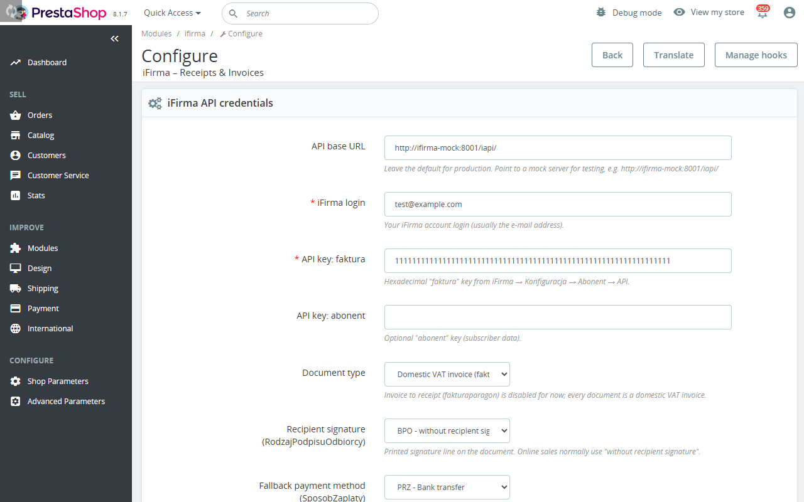

# Configuration

Settings of the iFirma module: the settings walk-through, every configuration key, the duplicate guard settings and the API rate limits.

[Back to README](../README.md)

## Settings walk-through



Open the module configuration and fill in:

- **API base URL.** The iFirma API address. Leave the default for production. The module accepts
  `https://` addresses. It accepts `http://` only when the shop is in developer mode (`_PS_MODE_DEV_`) or the
  host is `localhost`, a loopback or private address (`10.x`, `172.16` to `172.31`, `192.168.x`), or a single-label
  name such as a Docker service (`http://ifirma-mock:8001/iapi/`). An address with credentials in it (`user:pass@`)
  is refused, as is any address that breaks these rules; the settings page names the field.
- **API key: faktura** – the hexadecimal *faktura* key from
  iFirma → *Konfiguracja → Abonent → API → Klucze*.
- **Stored keys.** The three API key fields (*faktura*, *abonent* and *rachunek*) are password inputs, and the
  page never shows a stored key. The description says when a key is stored. Leaving a field empty keeps the stored
  key; typing a value replaces it. To delete a stored key, leave its field empty, tick **Remove the stored key**
  under it and save. Each key must be hexadecimal.
- **Document type** – *Domestic VAT invoice* (`fakturakraj`), the only enabled and default
  type. *Invoice to receipt* (`fakturaparagon`) is disabled for now; a stored `fakturaparagon`
  value is treated as `fakturakraj`.
- **Payment registration type** – URL token for the payment endpoint
  (default `prz_faktura_kraj`; adjust to your document/payment type).
- Optionally an **Auto‑create on order status** to issue documents automatically.
- **API key: abonent** (optional) – lets you read the remaining iFirma request limit of the account with the button **Check the remaining iFirma limit** on this page (see [Checking the remaining limit](#checking-the-remaining-limit)). The page never reads the limit by itself. Without the key the button is replaced by a hint to enter it.
- **Delivery channel** – *Shop e‑mail with PDF attached* (default), *iFirma e‑mail*
  (available for every created document, since `fakturakraj` is a documented send type) or
  *Do not send*. With the default channel, documents are e‑mailed to customers
  automatically on the next trigger; choose *Do not send* to disable. **E‑mail text** adds an
  optional message (up to 1000 characters).
- **Document template** – the name of the print template in your iFirma account (up to 100 characters, one line).
  The logo and the layout of the printed document belong to that template. They are configured in the iFirma
  account, and the module only names the template: it does not upload a logo or edit a template. Leave the field
  empty for the iFirma default.
- **Order stamp prefix** – the first segment of the order stamp the module writes into the document comments
  (default `PS-ORDER`; 1 to 32 characters of letters, digits, dot, underscore and hyphen; a trailing hyphen is
  dropped). When several shops issue documents in one iFirma account, give each shop its own prefix, and set it
  before the shop issues its first document. A prefix changed later does not rename the stamps already written.
- **Shop webpage** – the address of the shop for people who read the documents, an absolute `http://` or `https://`
  address (up to 255 characters, no user name or password). The module uses it in three places: as the link in
  its e‑mails, printed in the document comments, and as the first part of the PDF file names. Empty means the
  address of the shop itself.
- **Duplicate check**, **window (days, 1‑365)** and **amount tolerance** – look for an existing
  iFirma document before issuing a new one.
- **Allow customers to request billing data changes**, **Accept data change requests automatically** and
  **Notification e‑mail** (empty or a valid address; empty uses the shop address). The automatic mode is *Never*
  (every request waits for review, the default), *Safe changes only* (a request that keeps the company or private
  choice, the NIP and the company name, and changes only the name, address, postcode, city or country, is
  approved at once) or *Every valid request* (approved without review).
- **Status sync interval (1‑1440 minutes)** – how often an order page refreshes its document
  from iFirma; **Cron call budget (1‑90)**, **Cron items per job (1‑50)**, **API calls per minute (1‑100)** and
  **API calls per day (1‑15000)** – API usage caps and the size of one cron run.
- **Cron endpoint** – the module shows the cron URL with its secret token and a crontab
  example (`*/15 * * * * curl -fsS "<url>"`); *Regenerate cron token* replaces the token. Call it every 1 to 5 minutes:
  it issues the queued orders, so a longer interval delays them (see [Cron jobs](#cron-jobs)).
  The same page also shows the token-in-header form, which keeps the token out of the web server's access log:

  ```
  */15 * * * * curl -fsS -H "X-Ifirma-Token: <IFIRMA_CRON_TOKEN>" "https://<shop>/module/ifirma/cron" >/dev/null
  ```

  When both are sent, the `token` query parameter is the one checked. A wrong or missing token answers HTTP 403.
- **Calls paused after a rejected key.** When iFirma rejects the credentials (a `Kod` of 400, 401, 402, 403 or 499,
  or an HTTP 401 or 403), the module makes no call to iFirma for 15 minutes and the settings page shows a warning:
  *iFirma rejected the credentials at <time>: <message>; calls are paused until <time>*. Saving the settings form
  clears the pause at once, so save after you have corrected or re-entered the key. See
  [Troubleshooting](troubleshooting.md#calls-paused-after-a-rejected-key).

## Configuration keys

| Key | Default |
|---|---|
| `IFIRMA_BASE_URL` | iFirma API base URL; must be `https`, or `http` in developer mode or for a local, private or single-label host (see the walk-through) |
| `IFIRMA_USER`, `IFIRMA_KEY_FAKTURA`, `IFIRMA_KEY_ABONENT`, `IFIRMA_KEY_RACHUNEK` | empty |
| `IFIRMA_DOC_TYPE` | `fakturakraj` (the only enabled type; `fakturaparagon` is disabled for now and normalised to `fakturakraj`) |
| `IFIRMA_SIGNATURE_TYPE` (new) | `BPO`: recipient signature (`RodzajPodpisuOdbiorcy`), one of `OUP` (osoba upoważniona do otrzymania faktury VAT), `UPO` (upoważnienie), `BPO` (bez podpisu odbiorcy) or `BWO` (bez podpisu odbiorcy i wystawcy). Any other value, including the old `BRK`, is normalised to `BPO` when saved and when the payload is built. |
| `IFIRMA_PAYMENT_METHOD` | `PRZ` |
| `IFIRMA_PAYMENT_METHOD_MODE` (new) | `order` |
| `IFIRMA_PAYMENT_METHOD_MAP` (new) | empty |
| `IFIRMA_CONTRACTOR_SYNC` (new) | `1` |
| `IFIRMA_PAYMENT_TYPE_TOKEN` | `prz_faktura_kraj` |
| `IFIRMA_DEFAULT_UNIT` | `szt.` |
| `IFIRMA_AUTO_CREATE_STATE` | `0` |
| `IFIRMA_MARK_PAID_ON_CREATE` | `1` |
| `IFIRMA_SEND_CHANNEL` (new) | `shop_mail` |
| `IFIRMA_SEND_TEXT` (new) | empty |
| `IFIRMA_SEND_COPY_MODE` (new) | `none` (`none`, `shop`, `employee`; absent reads as `none`) |
| `IFIRMA_SEND_COPY_EMPLOYEE` (new) | `0` (employee id, used with mode `employee`) |
| `IFIRMA_KSEF_MODE` (new) | `b2b` (`b2b`, `all` or `off`; any other value is treated as `b2b`) |
| `IFIRMA_DUPLICATE_CHECK` (new) | `1` |
| `IFIRMA_DUPLICATE_WINDOW_DAYS` (new) | `60` |
| `IFIRMA_DUPLICATE_AMOUNT_TOLERANCE` (new) | `0.01` |
| `IFIRMA_DOC_TEMPLATE` (new) | empty (the name of the print template in the iFirma account, sent as `NazwaSzablonu` when not empty; one line of at most 100 characters; the logo is part of the template and is configured in the iFirma account) |
| `IFIRMA_ORDER_STAMP_PREFIX` (new) | `PS-ORDER` (first segment of the order stamp in the document comments; 1 to 32 characters of `A-Z a-z 0-9 . _ -`, a trailing `-` is dropped, empty becomes the default; one prefix per shop that shares an iFirma account, set before the first document) |
| `IFIRMA_SHOP_URL` (new) | empty (shop webpage: an absolute `http` or `https` address without user information, at most 255 characters; the link in the module's e-mails, printed in the document comments and the first part of PDF file names; empty means the shop's own address) |
| `IFIRMA_ALLOW_DATA_REQUEST` (new) | `1` |
| `IFIRMA_DATA_REQUEST_AUTO_ACCEPT` (new) | `none` (`none`, `safe` or `all`; any other value is read as `none`) |
| `IFIRMA_NOTIFY_EMAIL` (new) | empty |
| `IFIRMA_SYNC_INTERVAL_MIN` (new) | `15` |
| `IFIRMA_CRON_TOKEN` (new) | random 32 hex characters, generated on install/upgrade from the system's secure random generator (if that is unavailable, the install or upgrade fails with a message rather than using a weaker token) |
| `IFIRMA_CRON_MAX_CALLS` (new) | `40` (list calls of the status sync per run) |
| `IFIRMA_KSEF_SUBMITTER` (new) | `module` (`module` or `ifirma`; any other value is read as `module`). Who sends the invoices that go to KSeF under `IFIRMA_KSEF_MODE`: with `ifirma` the module never calls the KSeF send endpoint and only waits for the state iFirma reports. See [KSeF](usage.md#ksef-e-invoicing) |
| `IFIRMA_CRON_MAX_ITEMS` (new) | `10` (1 to 50: the most queued orders, KSeF submissions or deliveries each of those jobs handles in one cron run) |
| `IFIRMA_RATE_MAX_PER_MIN` (new) | `80` (1 to 100) |
| `IFIRMA_RATE_MAX_PER_DAY` (new) | `14000` (1 to 15000) |
| `IFIRMA_RATE_WINDOW` (new) | empty (internal rate-limit state of the minute: `<minute>:<count>`, incremented by one atomic database statement, so two requests at the same time cannot both pass the cap) |
| `IFIRMA_RATE_DAY_WINDOW` (new) | empty (the same for the calendar day: `<day>:<count>`) |
| `IFIRMA_RATE_BACKOFF_UNTIL` (new) | empty (internal: the unix time until which iFirma asked the module to wait after it refused a request for exceeding its limit; no request is sent before it, see [Rate limits](#rate-limits)) |
| `IFIRMA_REMOTE_LIMIT` (new) | empty (internal: the last reading of the day limit from iFirma, `<day>:<used>:<granted>:<unix time>`; needs the `abonent` key, see [Rate limits](#rate-limits)) |
| `IFIRMA_AUTH_FAILURE` (new) | empty (internal mark of the pause after a rejected key: `<unix time>|<message>`; set by a failed call, cleared by a successful save of the settings; after 15 minutes the mark no longer pauses calls) |
| `IFIRMA_SEEN_<id_employee>` (new) | not set (internal: the time an employee last opened the iFirma tab of the notification bell) |

## Duplicate guard settings

Settings of the [Duplicate guard](usage.md#duplicate-guard):

| Key | Default | Meaning |
|---|---|---|
| `IFIRMA_DUPLICATE_CHECK` | `1` | `0` disables the guard; only the local record check applies |
| `IFIRMA_DUPLICATE_WINDOW_DAYS` | `60` | largest window (days) for the unfiltered query |
| `IFIRMA_DUPLICATE_AMOUNT_TOLERANCE` | `0.01` | allowed gross difference when matching |

## Behind a reverse proxy

The guest page limits the codes it sends per client address (20 per hour). The address is the one PrestaShop reports
(`Tools::getRemoteAddr()`). Behind a reverse proxy or a CDN that address is the proxy's, or, when PrestaShop trusts a
forwarded header such as `X-Forwarded-For` without checking where it came from, an address the visitor can choose. In both
cases the per-address cap is weaker than it looks. Configure the trusted proxies of your PrestaShop and the web server so
that the real client address is reported, and keep the per-order limits (one code per 60 seconds, 5 per 24 hours), which do
not depend on the address, in mind as the cap that always holds.

## Permissions

The module has three permission levels. They are the View, Add and Edit permissions that
**Advanced Parameters > Team > Permissions** shows for the **iFirma documents** tab under **Orders**
(the tab `AdminIfirma`):

| Level | Permission | What it allows |
|---|---|---|
| View | View | See the iFirma panel on the order page and on the customer page, the iFirma column of the Orders list, the [iFirma documents list](usage.md#ifirma-documents-list) and the iFirma tab of the notification bell, and download a document PDF. Check, search and count a customer's contractor. |
| Issue | Add | Create Receipt, Issue anyway, Link this document (a duplicate candidate) and Register contractor in iFirma. On the Orders list: the Issue action of a cell and the bulk Issue iFirma documents. On the documents list: Retry issuance and its bulk action. |
| Manage | Edit | Update status in iFirma, Send again, Send to KSeF, Refresh from iFirma, and Approve or Reject a data-change request. On the documents list: Send again, Refresh and their bulk actions. |

Defaults: the SuperAdmin profile and the profile of the employee who installed the module hold all
three levels (PrestaShop grants them when the tab is created). Every other profile has none until you
grant them, so after an upgrade grant View (and the others as needed) to each profile that works with
the documents. The levels are independent of each other: grant View together with Issue or Manage, because
a panel that cannot be seen cannot be used. The Delete permission of the tab has no effect, as the module
never deletes a document.

PrestaShop runs a module's back-office hooks only for profiles that may **view the module itself**: on the
same Permissions page, under **Modules**, the iFirma module needs its **View** permission too. Without it the
order panel, the customer panel, the Orders-list column and the notification tab stay hidden even when the
tab's View is granted (the AJAX actions still follow the tab levels). Grant both.

The **Configure** permission of the module page (Modules > Module Manager) is separate: it controls who
may open and save the settings and does not give any of the three levels.

Link, Unlink and Register on the customer page need, on top of View, the Edit permission on **Customers**.

## Cron jobs

One request to the cron endpoint (`/module/ifirma/cron`, token in the query or in the `X-Ifirma-Token` header) runs four jobs in
a fixed order, under a run lock, after reading the day limit from iFirma (see [Rate limits](#rate-limits)), and answers
with one JSON summary. The order is chosen so that work reaches the customer
as early as possible: customer-facing issuance first, a KSeF submission before the sync that reads its state, delivery last so
that an acceptance read by the sync is delivered in the same run.

| # | Job | What it does |
|---|-----|--------------|
| 1 | `queue` | Issues queued orders, oldest first, through the whole issuance pipeline (duplicate guard included), under each order's lock, at most `IFIRMA_CRON_MAX_ITEMS` per run. Stops at the first rate limit refusal. See [Queued issuance](usage.md#queued-issuance). |
| 2 | `ksef` | Submits invoices to KSeF whose submission was deferred (submitter `module`, no KSeF state yet). See [KSeF](usage.md#ksef-e-invoicing). |
| 3 | `sync` | The status sync of issued documents (documents that wait for KSeF are always due), within `IFIRMA_CRON_MAX_CALLS` list calls. |
| 4 | `delivery` | Delivers documents that wait for KSeF acceptance and were accepted, at most `IFIRMA_CRON_MAX_ITEMS`. |

All four share the rate guard (the minute and the day cap and the back-off). After a job reports that the rate limit stopped
it, the later jobs do not start and only report what is left. **Only one cron run works at a time**: a request that arrives
while another run holds the run lock makes no iFirma request and answers `{"skipped": "another cron run is busy"}`. An order
whose own lock is held (an employee clicking Create, a status change) is skipped by the queue job and stays queued.

The answer keeps the keys of the status sync at its top level, unchanged (`receipts_checked`, `updated`, `marked_paid`,
`marked_missing`, `errors`, `rate_limited`, `calls`, `dates_total`, `dates_processed`, `held_orders`, `started_at`,
`finished_at`, `auth_blocked`, `message`), and adds:

```json
{
  "queue":    {"handled": 4, "succeeded": 4, "failed": 0, "left": 12},
  "ksef":     {"handled": 0, "succeeded": 0, "failed": 0, "left": 0},
  "delivery": {"handled": 1, "succeeded": 1, "failed": 0, "left": 0},
  "rate_limited": 0,
  "rate_limited_window": ""
}
```

`handled` counts the items the job tried, `left` what still waits. `rate_limited` is 1 when the rate limit stopped the run
(the sync's own count, when it was the one, is kept), and `rate_limited_window` then says which window: `minute`, `day` or
`backoff`. A job that did not run because an earlier one was rate limited reports zeros and its `left`.

## Rate limits

iFirma allows 100 requests per minute and 15,000 per day. The module keeps its own counters for both
windows (`IFIRMA_RATE_WINDOW` for the calendar minute, `IFIRMA_RATE_DAY_WINDOW` for the calendar day) and refuses to
start a request once either local cap is reached. The caps are `IFIRMA_RATE_MAX_PER_MIN` (default 80, 1 to 100)
and `IFIRMA_RATE_MAX_PER_DAY` (default 14,000, 1 to 15,000), both on the settings page; they stay below
iFirma's own limits on purpose. The minute is checked first. The day is the calendar day of the shop's time
zone; iFirma's own day is presumably Polish time, and the 1,000-request margin below 15,000 absorbs a mismatch
around midnight. A refusal names the window that refused ("... requests in the current minute (cap 80)" or
"... requests today (cap 14000)") and is a transient "rate limited" error, never stored as a document error.
A request refused by the day window has already used a minute slot; that only makes the guard more conservative.
Timeouts: 30 s by default, 5 s for
the customer-page sync. A shop-mail delivery may add up to 10 s of waiting when the PDF is not ready yet. With the optional `abonent` key the remaining daily limit can be read on request (see [Checking the remaining limit](#checking-the-remaining-limit)).

A bulk run of the documents list stops at the first refusal and reports the rest as "not attempted" (see
[iFirma documents list](usage.md#ifirma-documents-list)). The cURL transport accepts only the HTTP and HTTPS protocols,
does not follow redirects, and cuts off an answer larger than 20 MB with an error.

**When iFirma refuses a request.** An HTTP 429 answer, or an answer whose message says the request limit was exceeded
("limit zapytań"), is treated as "rate limited", not as an error, an unknown outcome or a rejected key. The module then sends
nothing until the time given by the `Retry-After` header (whole seconds, at most 24 hours), or until the start of the next
minute when the header is missing or unusable (`IFIRMA_RATE_BACKOFF_UNTIL`). A request started during the back-off is refused
before any network call, with a message that names the end time. See
[Rate limited by iFirma](troubleshooting.md#rate-limited-by-ifirma).

The limits are shared by ALL API clients of your account (other integrations, accounting tools). The module counts
its own requests, so without the `abonent` key a busy account can reach iFirma's limit before the module reaches its cap;
lower the caps when other programs use the same account.

**Reading the current limit from iFirma.** With the optional `abonent` key entered on the settings page, the first step of
every cron run reads the day limit (`GET iapi/abonent/limit.json`: used and granted requests). The module raises its day
counter to the number iFirma counts, so requests made by other clients count against the cap, and it never lets the day cap
exceed the limit iFirma granted (a smaller grant lowers the cap for that day). A reading is reused for 10 minutes, so the
extra request is made at most about six times an hour. The cron answer reports it in a `limit` block
(`used`, `granted`, `remaining`; all `null` without the key or when iFirma does not answer). A failed read changes nothing:
the module goes on with its local counters.

### Module requests

The settings page has a **Module requests** box above the settings form. It shows what the module itself counted, with or
without the `abonent` key, and it sends no request to iFirma to do so:

- **Current minute** and **Today**: the requests the module sent in this calendar minute and today, next to the caps
  (for example "6 of 80" and "250 of 14000").
- **Today by kind of request**: the same requests split by what they were for. Every kind is listed, with a zero when
  nothing of that kind was sent today.
- A notice with the time when a back-off after an iFirma limit answer ends, while one runs: until then the module sends nothing.
- **Other clients of the account**, when the day count is higher than the kinds add up to. After a reading of the limit
  the module raises its day counter to what iFirma counts (other programs of the account use the same limit); the
  difference is shown here.

Every request the module sends is counted once, under exactly one kind, and a request that was refused locally before it
was sent is not counted. A request that iFirma answered with an error is counted, because it used the limit.

| Kind | What it covers |
| --- | --- |
| `document` (Creating documents) | Creating a receipt or an invoice. |
| `status` (Status checks) | Reading the document list (the status sync, the documents list, the customer page sync) and the detail of one document. Status checks count toward the limit like any request. |
| `pdf` (PDF downloads) | Downloading a document PDF: the customer download, the back-office download and the PDF a shop-mail delivery attaches (each attempt counts, also when the first answer was "not ready"). |
| `email` (Sending documents by e-mail through iFirma) | The iFirma e-mail send of a document (delivery channel iFirma e-mail). |
| `ksef` (KSeF submissions) | Submitting an invoice to KSeF. |
| `payment` (Payments) | Registering a payment. |
| `contractor` (Contractors) | Looking up, creating or updating a contractor, and the contractor import. |
| `limit` (Limit checks) | Reading the day limit: the cron's first step and every click on **Check the remaining iFirma limit**. |
| `other` (Other requests) | Any request that matches none of the kinds above. |

The counts of one day are kept in `IFIRMA_USAGE_<KIND>` (`<day>:<count>`); they are statistics only and never refuse a request.
The cron answer carries the same numbers in its `usage` block (see [Cron jobs](#cron-jobs)).

### Checking the remaining limit

With the `abonent` key set, the **iFirma request limit** box shows the last reading of the account's day limit: requests
used, granted and remaining, and the time of the reading. Opening the page does not read the limit. Before the first reading
the box says that the limit was not checked yet; a reading from an earlier day is shown with its date and is not presented
as today's figure; when nothing is left the box says that the module sends no request to iFirma until tomorrow.

The button **Check the remaining iFirma limit** reads a fresh figure. One click sends exactly one request (`GET abonent/limit.json`),
always a new one even when the cron read the limit a minute ago, and that request counts toward the minute and day limit as kind
`limit` (five clicks in a minute are five requests, and the minute cap applies to the sixth). The reading is stored and the module's
day counter is raised to iFirma's figure, never lowered, as the cron does.

When the check cannot be done the box says why and keeps the earlier reading and the counters:

- **Refused by the module's own limit** (the minute or day cap, a running back-off, or the pause after a rejected key): nothing
  was sent; the box names the limit.
- **iFirma error, a refused `abonent` key or an unusable answer**: the box says the limit is currently unavailable. The detail is
  in the PrestaShop log (Advanced Parameters, Logs), never on the page, and no key is shown or logged.

**The module's own count is not the account's count.** The module counts only its own requests. The account's limit is shared
with every other program that uses the iFirma API, so the figure iFirma reports can be higher than the module's day count until
a reading raises the counter. The button is a POST of the settings page itself (back-office token) and is accepted only from an
employee who may configure the module; a request that is not a POST, has no key to use or comes from an employee without
that right sends nothing.
